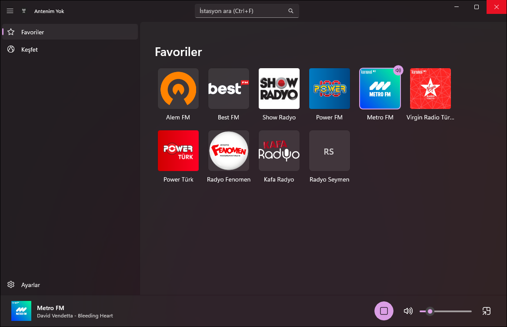
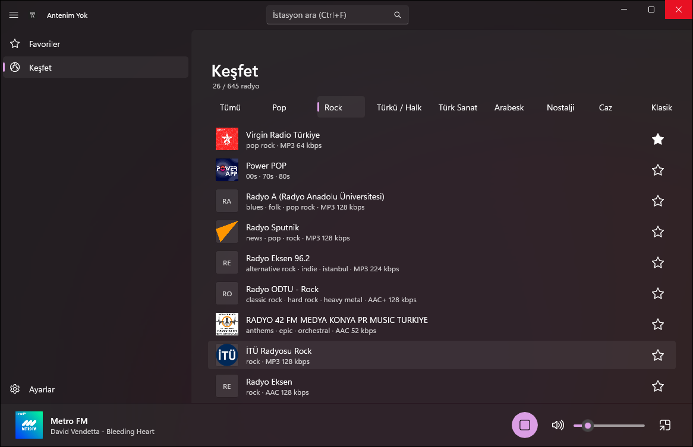
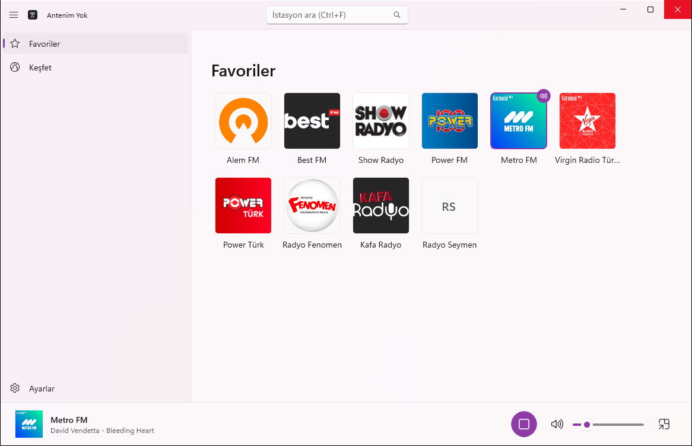
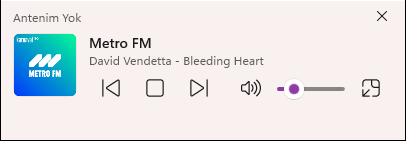
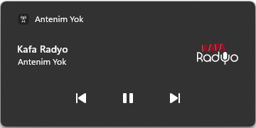
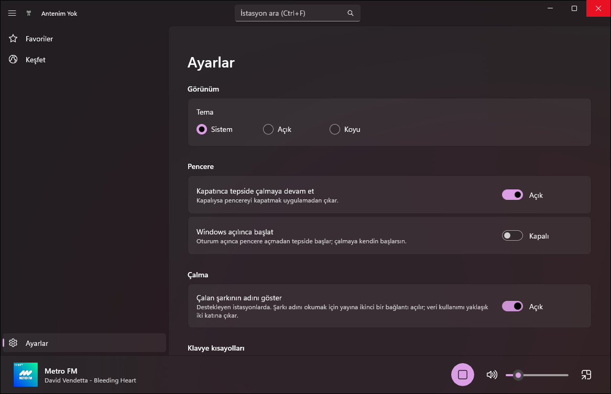

# Antenim Yok 📻

> Reklam yok, anten yok, dert yok.

Türk radyolarını reklamsız, sade bir pencereden dinlemek için **Windows 11** uygulaması.
Favorilerini seç, tek tıkla çal; pencereyi kapat, tepside çalmaya devam etsin.

<p align="center">
  
</p>

## İndir

**[Windows için son sürümü indir →](https://github.com/egeckmk/antenim-yok/releases?q=Windows&expanded=true)** `Ege.AntenimYok-win-Setup.exe` dosyasını çalıştırman yeterli.

- Yönetici izni istemez; birkaç saniyede kurulur ve açılır.
- Kendini güncel tutar: yeni sürüm arka planda iner, "Yeniden başlat" deyince yüklenir.
- Windows 10 (1809+) / Windows 11, 64 bit.

> Uygulama imzalı değil. Windows "Windows kişisel bilgisayarınızı korudu" derse **Ek bilgi → Yine de çalıştır**.

## Neler var

| | |
|---|---|
| **Favoriler** | Sevdiğin istasyonlar logolarıyla bir ızgarada; tıkla çal, tekrar tıkla durdur. |
| **Keşfet** | Türkiye'deki 600'den fazla radyo ([Radio Browser](https://www.radio-browser.info)); ada göre ara, türe göre süz (Pop, Rock, Türkü, Türk Sanat, Arabesk, Nostalji, Caz…), yıldızla favorilere ekle. |
| **Şarkı adı** | Destekleyen istasyonlarda çalan şarkı alt çubukta, mini oynatıcıda ve Windows medya kartında görünür. |
| **Windows ile uyumlu** | Klavye medya tuşları, Hızlı Ayarlar'daki medya kartı, tepsi simgesi, açık/koyu tema, Mica. |
| **Mini oynatıcı** | Her zaman üstte duran küçük pencere: önceki / durdur / sonraki ve ses. |
| **Kopmaz** | Bir yayın açılmazsa yedeğine geçer; bağlantı koparsa kendi kendine yeniden bağlanır. |
| **Sade** | Hesap yok, reklam yok, veri toplama yok. Favoriler ve ayarlar yalnızca senin bilgisayarında. |

## Ekran görüntüleri

<table>
  <tr>
    <td width="50%"><br><sub><i>Keşfet: türe göre süz, yıldızla favorilere ekle</i></sub></td>
    <td width="50%"><br><sub><i>Açık tema</i></sub></td>
  </tr>
  <tr>
    <td><br><sub><i>Her zaman üstte mini oynatıcı</i></sub><br><br>
        <br><sub><i>Windows medya kartı ve medya tuşları; karta tıklayınca uygulama açılır</i></sub></td>
    <td><br><sub><i>Ayarlar: tema, tepside çalma, Windows ile başlat, şarkı adı</i></sub></td>
  </tr>
</table>

## Klavye kısayolları

| Tuş | Ne yapar |
|---|---|
| `Boşluk` | Çal / durdur |
| `Ctrl` + `1`…`9` | Sıradaki favoriyi çal |
| `Ctrl` + `F` | İstasyon ara |
| `Ctrl` + `↑` / `↓` | Sesi aç / kıs |
| `M` | Sessiz |
| Medya tuşları | Çal/durdur, önceki/sonraki favori |

## Sık sorulanlar

**Bazı istasyonlarda şarkı adı neden çıkmıyor?**
Şarkı adını istasyonun kendisi göndermeli. Bazı yayınlar göndermiyor, HLS yayınlarda da bu yöntem çalışmıyor. Ayarlar'dan tamamen kapatabilirsin (şarkı adı için yayına ikinci bir bağlantı açılıyor).

**Bir istasyon çalmıyor.**
İstasyon bilgileri topluluk tarafından tutulan Radio Browser'dan gelir; bazen adres eskir. Keşfet'te aynı istasyonun başka bir kaydını dene. Bazı kurum ağları radyo yayınlarını engeller.

**Kurulum neden yaklaşık 90 MB?**
Uygulama .NET ve Windows App SDK'yı kendi içinde taşır; bilgisayarına ayrıca bir şey kurman gerekmez.

**Verilerim nerede, nasıl kaldırırım?**
Uygulama `%LOCALAPPDATA%\Ege.AntenimYok`, favoriler ve ayarlar `%LOCALAPPDATA%\AntenimYok` klasöründe. **Ayarlar → Uygulamalar → Antenim Yok → Kaldır** uygulamayı siler; favorilerini de silmek istersen ikinci klasörü elle sil.

**İnternette nereye bağlanıyor?**
Yalnızca çaldığın istasyonun yayınına, istasyon logolarına, Keşfet için Radio Browser'a ve güncellemeler için GitHub'a.

## Geliştirme

.NET 10 SDK ve Windows 11 yeterli.

```powershell
dotnet build AntenimYok.slnx -c Debug -p:Platform=x64   # derle
dotnet test tests/AntenimYok.Tests                      # testler
dotnet tool restore; .\scripts\publish.ps1 -Install     # Setup.exe üret ve bu bilgisayara kur
```

| Klasör | İçerik |
|---|---|
| `src/AntenimYok.Core` | Platformdan bağımsız mantık: çalma ve yedek akış, yeniden bağlanma, Radio Browser, şarkı adı (ICY), favoriler, ayarlar |
| `src/AntenimYok.App` | WinUI 3 arayüzü, MediaPlayer, medya tuşları, tepsi, güncelleme (Velopack) |
| `tests/AntenimYok.Tests` | xUnit testleri |

Değişiklikler (Windows): [CHANGELOG.md](CHANGELOG.md) · Plan: [docs/PLAN.md](docs/PLAN.md) · Sürümleme: [SemVer](.claude/skills/versioning/SKILL.md).
Uygulama [Claude Code](https://claude.com/claude-code) yardımıyla geliştirildi. 

## iPhone ve Mac (App Store)

iPhone ve Mac için aynı SwiftUI uygulaması App Store'a çıkıyor (tek kayıt, mağaza sayfası Türkçe): Favoriler, Keşfet, kilit ekranı /
Denetim Merkezi kartı ve AirPods, Mac'te menü çubuğu ve mini oynatıcı. Kaynak `apple/` altında; mantık `apple/AntenimYokCore` Swift paketinde.
Gizlilik: [docs/privacy.md](docs/privacy.md) · Destek: [Issues](https://github.com/egeckmk/antenim-yok/issues) · Değişiklikler: [apple/CHANGELOG.md](apple/CHANGELOG.md).

Kaynaktan derlemek için `apple/` altında: `brew install xcodegen`, `cp Config/Local.xcconfig.example Config/Local.xcconfig` ve dosyaya kendi
Apple Team ID'ni yaz (`DEVELOPMENT_TEAM = XXXXXXXXXX`; dosya git'e girmez), sonra `xcodegen generate` ve `AntenimYok.xcodeproj`'i aç.

## Lisans

Copyright © 2026 Ege Çakmak. [GNU General Public License v3.0](LICENSE) ile lisanslanmıştır:
kodu kullanabilir, değiştirebilir ve dağıtabilirsin; değiştirilmiş sürümü dağıtırsan onun kaynak kodunu da aynı lisansla açman gerekir.
Lisansa, uygulamanın App Store gibi mağazalardan dağıtılmasına izin veren bir ek izin eklenmiştir (bkz. [LICENSE](LICENSE), "Additional permission").

---

Yayınlar ve logolar ilgili radyo istasyonlarına aittir; Antenim Yok yalnızca herkese açık internet yayınlarını çalar ve ticari değildir.
